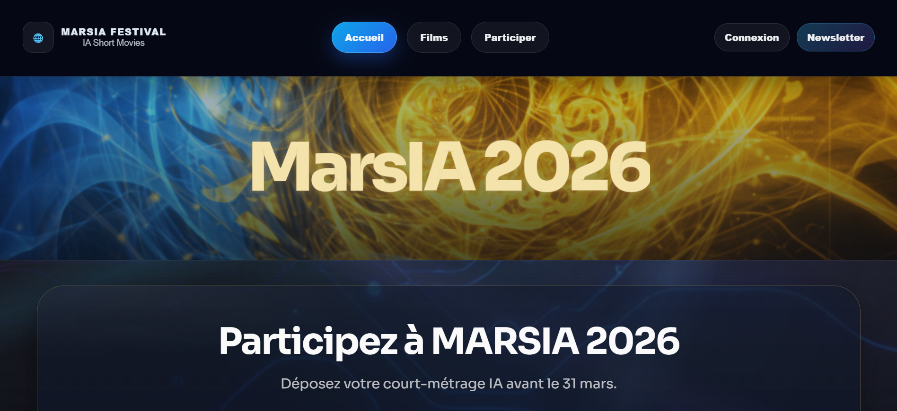
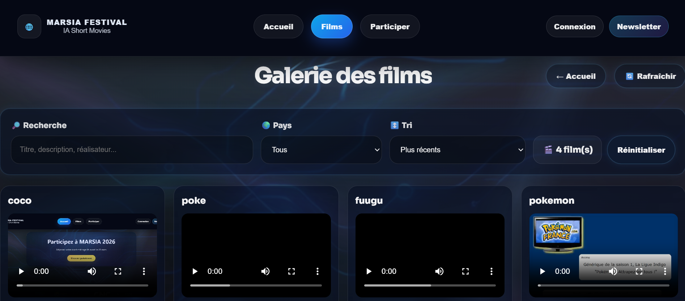
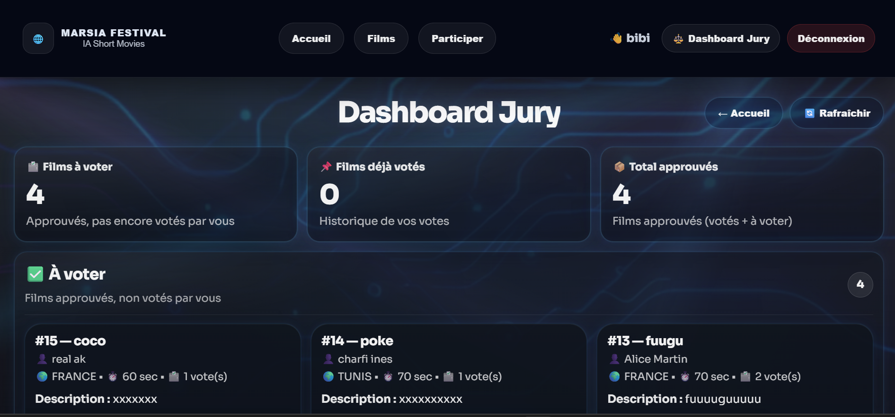
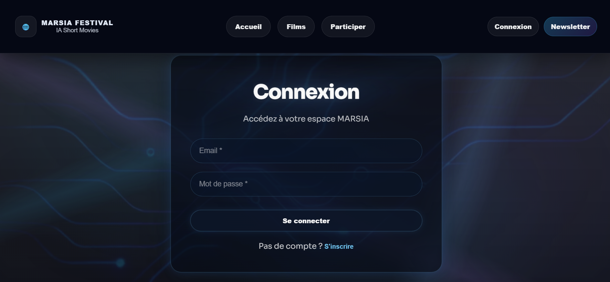

<p align="center">
  
</p>

# 🎬 MARS.IA 2026 - Festival International du Court-Métrage par Intelligence Artificielle


**MARS.IA** est une plateforme web Fullstack conçue pour l'organisation et la gestion d'un festival cinématographique dédié aux **œuvres générées par Intelligence Artificielle** (Midjourney, Runway Gen-2, Sora, Pika, ElevenLabs...).

L'application propose une expérience immersive au design cyberpunk futuriste, animée par un arrière-plan vidéo dynamique et des composants **GSAP**. Elle orchestre le cycle de vie complet du festival : de la soumission des œuvres jusqu'aux délibérations du jury et à la billetterie publique.

---

## 🏛️ Espaces Utilisateurs & Fonctionnalités Clés (RBAC)

L'écosystème segmente les accès en 4 profils d'utilisateurs distincts :

```text
               ┌────────────────────────────────────────────────────────┐
               │              PLATEFORME DU FESTIVAL MARS.IA            │
               └────────────────────────────────────────────────────────┘
                                           │
         ┌───────────────────┬─────────────┴───────┬────────────────────┐
         ▼                   ▼                     ▼                    ▼
   [ 🌐 PUBLIC ]     [ 🎬 RÉALISATEUR ]      [ 🗳️ JURY ]        [ 🔐 ADMIN ]
   • Découverte      • Soumission d'œuvres  • Accès privé      • Dashboard Stats
   • Outils IA       • Tagging d'outils     • Système de vote  • Modération films
   • Réservations    • Galerie personnelle  • Notation 0 à 10  • Gestion comptes
   • Newsletter      • Profil & Bio         • Délibérations    • Billetterie
```

1. **Espace Public (Visiteurs & Passionnés)** :
    * Consultation du catalogue des films en compétition avec lecteurs vidéo intégrés.
    * Répertoire encyclopédique des technologies d'IA générative utilisées pour chaque création.
    * Module de réservation pour les projections physiques et ateliers du festival.
    * Inscription à la newsletter officielle multilingue.
2. **Espace Candidats (`REALISATEUR`)** :
    * Formulaire de candidature pour soumettre un court-métrage (titre, synopsis, durée, pays).
    * Association des outils d'IA utilisés via une table relationnelle dédiée (`film_outil_ia`).
3. **Espace Délibération (`JURY`)** :
    * Dashboard privé d'évaluation réservé aux membres accrédités du jury.
    * Grille de notation sur 10 points et rédaction de rapports critiques pour chaque œuvre.
4. **Supervision Globale (`ADMIN`)** :
    * Tableau de bord analytique en temps réel : volume d'inscrits, total des films soumis, statistiques de votes.
    * Workflow de modération : validation ou rejet des films soumis avant publication sur la galerie publique.
    * Administration des comptes utilisateurs et gestion du contrôle d'accès.

---

## 🏗️ Architecture Technique (Fullstack JavaScript)

L'application repose sur un découpage découplé moderne garantissant des temps de réponse instantanés :

```text
  [ Client React SPA (Vite + Tailwind) ]
                     │
                     ▼ (Appels HTTP REST / Headers JWT)
       [ API REST Express.js (Node.js) ]
                     │
         ┌───────────┴───────────┐
         ▼                       ▼
  [ MySQL 8.0 : marsia ]   [ Stockage Fichiers ]
   (Pool de connexions)     (Uploads MP4 Multer)
```

### Backend (Node.js / Express / MySQL) :
* **Architecture MVC Modulaire** : Découpage strict en `controllers/`, `routes/`, `middlewares/` et `config/`.
* **Persistance Relationnelle Haute Disponibilité** : Utilisation de **Connection Pooling** (`mysql2/promise`) pour prévenir toute rupture de socket sous forte charge.
* **Sécurité & Authentification** :
    * Chiffrement irréversible des mots de passe via **BCrypt**.
    * Émission de jetons **JWT (JSON Web Token)** signés et sécurisés pour les sessions étanches.
    * Middlewares défensifs (`auth.middleware.js`, `requireRoles.middleware.js`).
* **Gestion des Médias** : Pipeline d'upload de fichiers vidéo avec **Multer**.

### Frontend (React / Vite / Tailwind) :
* **Architecture Single Page Application (SPA)** fluide et réactive.
* **Design Immersif Cyberpunk** : Système de tokens de styles, thématiques sombres et vidéo d'arrière-plan vectorisée.
* **Bibliothèque d'Animation GSAP** : Transitions de titres et d'interfaces cinématiques.

---

## 🗄️ Modèle de Données Relationnel (MySQL)

Le schéma relationnel comprend 8 tables optimisées avec indexation B-Tree :

* **`utilisateur`** : Gestion des comptes, rôles RBAC et statut d'activation.
* **`biographie`** : Métadonnées artistiques des réalisateurs (`ON DELETE CASCADE`).
* **`film`** : Entité centrale des créations cinématographiques et statut de modération.
* **`vote`** : Notes d'évaluation du jury liées au film et à l'accrédité.
* **`outil_ia`** & **`film_outil_ia`** : Répertoire et association N:M des technologies d'IA.
* **`notification`** & **`newsletter`** : Modules de communication et alertes système.

---
---

## 📸 Aperçu de l'Interface

| Page d'Accueil & Appel à Projets | Galerie des Courts-Métrages IA |
| :---: | :---: |
|  |  |

| Dashboard d'Évaluation du Jury | Espace Connexion Cyberpunk |
| :---: | :---: |
|  |  |

---


## 🚀 Installation & Lancement Local

### Prérequis
* **Node.js** (v18 ou supérieur) et **npm**.
* Un serveur **MySQL** actif (port 3308 ou 3306).

### 1. Cloner le projet
```bash
git clone https://github.com/Akh138/FESTIVAL_MARSIA.git
cd FESTIVAL_MARSIA
```

### 2. Initialiser la base de données
Importez le script SQL fourni à la racine dans votre client MySQL (Workbench, phpMyAdmin ou terminal) :
```sql
SOURCE database.sql;
```

### 3. Lancer le Backend (API Express)
```bash
cd backend
npm install
npm start
```
*(Le serveur démarre sur `http://localhost:8081`).*

### 4. Lancer le Frontend (Interface React)
Dans un second terminal :
```bash
cd frontend
npm install
npm run dev
```
*(L'interface démarre sur `http://localhost:5173`).*

---

## 🔑 Identifiants de Démonstration (Comptes de Test)

Le fichier `database.sql` injecte automatiquement des comptes préconfigurés :

| Rôle | Email | Mot de passe | Permissions |
| :--- | :--- | :--- | :--- |
| **Superviseur (Admin)** | `sophie@leroy.fr` | `admin123` | Accès Backoffice, stats & modération |
| **Membre du Jury** | `jean@dupont.com` | `admin123` | Évaluation & notation des films |
| **Réalisateur** | `alice@martin.fr` | `admin123` | Soumission de projets & profil |

---

## 💡 Note de Réalisation & Retour d'Expérience

Ce projet **MARS.IA** illustre ma polyvalence technique au-delà de l'écosystème Java/Spring Boot :

* **Maîtrise de l'écosystème JavaScript moderne** : Conception d'une API REST complète avec Express.js et d'un frontend réactif avec React 18, Vite et Tailwind.
* **Gestion du cycle de vie des données relationnelles** : Conception du schéma SQL avec contraintes d'intégrité, clés étrangères et indexation des requêtes critiques.
* **Contrôle d'accès et sécurité** : Mise en œuvre du protocole JWT pour sécuriser les routes sensibles et découper l'expérience utilisateur selon les habilitations.

---
**Habib (Akh138)**  
*Développeur Fullstack Java & JavaScript*